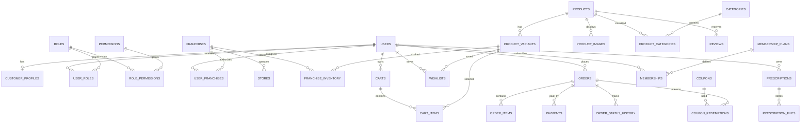

# Dream Spex Backend Phase 1 — Database Design

Target: MySQL 8/MariaDB compatible relational schema, InnoDB, `utf8mb4`, UTC timestamps, and application-generated UUIDs (`CHAR(36)`) unless a deployment standard requires `BINARY(16)`. Monetary values use `DECIMAL(12,2)`; never use floating point for money.

## Conventions

- Every table has `id CHAR(36) PRIMARY KEY`, `created_at DATETIME(6) NOT NULL`, and `updated_at DATETIME(6) NOT NULL` unless noted.
- Status values are application enums validated by Bean Validation and database constraints where supported.
- Soft deletion is preferred for catalog/users/franchises (`deleted_at DATETIME(6) NULL`) where history must remain.
- Files are stored in object storage; tables store object key, checksum, MIME type, and metadata, not large binary blobs.
- Foreign keys use `ON DELETE RESTRICT` for financial/history records and `ON DELETE CASCADE` for owned child rows where safe.

## Tables

### Identity, roles, and customer/franchise ownership

#### `users`

`id`, `email VARCHAR(255) NULL`, `phone VARCHAR(32) NULL`, `password_hash VARCHAR(255) NOT NULL`, `display_name VARCHAR(160) NOT NULL`, `status VARCHAR(24) NOT NULL` (`PENDING_VERIFICATION`, `ACTIVE`, `LOCKED`, `DISABLED`), `email_verified_at DATETIME(6) NULL`, `phone_verified_at DATETIME(6) NULL`, `last_login_at DATETIME(6) NULL`, `failed_login_count SMALLINT UNSIGNED NOT NULL DEFAULT 0`, `locked_until DATETIME(6) NULL`, `deleted_at DATETIME(6) NULL`. PK `id`; unique normalized email and phone (nullable); indexes `(status)`, `(deleted_at)`.

#### `roles`

`id`, `code VARCHAR(40) NOT NULL`, `name VARCHAR(80) NOT NULL`, `description VARCHAR(255) NULL`. Unique `code`. Seed `CUSTOMER`, `FRANCHISE_ADMIN`, `SUPER_ADMIN`.

#### `permissions`

`id`, `code VARCHAR(100) NOT NULL`, `name VARCHAR(120) NOT NULL`. Unique `code`.

#### `user_roles`

`user_id CHAR(36)`, `role_id CHAR(36)`. Composite PK `(user_id, role_id)`, FKs to users/roles, index `(role_id, user_id)`.

#### `role_permissions`

`role_id CHAR(36)`, `permission_id CHAR(36)`. Composite PK, FKs to roles/permissions.

#### `customer_profiles`

`id`, `user_id CHAR(36) NOT NULL UNIQUE`, `first_name VARCHAR(80)`, `last_name VARCHAR(80)`, `date_of_birth DATE NULL`, `gender VARCHAR(32) NULL`, `marketing_opt_in BOOLEAN NOT NULL DEFAULT FALSE`, `wallet_balance DECIMAL(12,2) NOT NULL DEFAULT 0`, `membership_status VARCHAR(24) NOT NULL DEFAULT 'NONE'`. FK to users; index `(membership_status)`.

#### `franchises`

`id`, `code VARCHAR(40) NOT NULL UNIQUE`, `name VARCHAR(160) NOT NULL`, `owner_name VARCHAR(160) NOT NULL`, `email VARCHAR(255) NOT NULL`, `phone VARCHAR(32) NOT NULL`, `address_line1 VARCHAR(255) NOT NULL`, `address_line2 VARCHAR(255) NULL`, `city VARCHAR(100) NOT NULL`, `state VARCHAR(100) NOT NULL`, `postal_code VARCHAR(16) NOT NULL`, `country_code CHAR(2) NOT NULL`, `gst_number VARCHAR(32) NULL UNIQUE`, `business_type VARCHAR(120) NULL`, `status VARCHAR(24) NOT NULL` (`ACTIVE`, `INACTIVE`, `SUSPENDED`), `opening_hours JSON NULL`, `services JSON NULL`, `deleted_at DATETIME(6) NULL`. Index `(status)`, `(city, state)`.

#### `franchise_profiles`

`id`, `franchise_id CHAR(36) NOT NULL UNIQUE`, `contact_user_id CHAR(36) NULL`, `admin_email VARCHAR(255) NOT NULL`, `admin_name VARCHAR(160) NOT NULL`, `location_label VARCHAR(160) NULL`. FKs to franchises/users.

#### `user_franchises`

`user_id CHAR(36)`, `franchise_id CHAR(36)`, `scope_status VARCHAR(24) NOT NULL DEFAULT 'ACTIVE'`, `assigned_at DATETIME(6) NOT NULL`, `revoked_at DATETIME(6) NULL`. Composite PK `(user_id, franchise_id)`, FKs, index `(franchise_id, scope_status)`. A franchise admin must have exactly the authorized rows enforced by service authorization.

#### `addresses`

`id`, `user_id CHAR(36) NOT NULL`, `label VARCHAR(60) NULL`, `recipient_name VARCHAR(160) NOT NULL`, `phone VARCHAR(32) NOT NULL`, `line1 VARCHAR(255) NOT NULL`, `line2 VARCHAR(255) NULL`, `city VARCHAR(100) NOT NULL`, `state VARCHAR(100) NOT NULL`, `postal_code VARCHAR(16) NOT NULL`, `country_code CHAR(2) NOT NULL`, `latitude DECIMAL(10,7) NULL`, `longitude DECIMAL(10,7) NULL`, `is_default BOOLEAN NOT NULL DEFAULT FALSE`, `deleted_at DATETIME(6) NULL`. Coordinates are optional but must be stored as a valid pair, with latitude in [-90, 90] and longitude in [-180, 180] (Flyway V33). FK user; index `(user_id, is_default)`.

### Catalog and inventory

#### `categories`

`id`, `name VARCHAR(120) NOT NULL`, `slug VARCHAR(140) NOT NULL UNIQUE`, `description TEXT NULL`, `image_url VARCHAR(1000) NULL`, `status VARCHAR(24) NOT NULL DEFAULT 'ACTIVE'`, `sort_order INT NOT NULL DEFAULT 0`, `deleted_at DATETIME(6) NULL`. Index `(status, sort_order)`.

#### `products`

`id`, `sku VARCHAR(80) NOT NULL UNIQUE`, `name VARCHAR(180) NOT NULL`, `slug VARCHAR(220) NOT NULL UNIQUE`, `brand VARCHAR(120) NOT NULL`, `description TEXT NOT NULL`, `material VARCHAR(80) NULL`, `gender VARCHAR(40) NULL`, `frame_shape VARCHAR(80) NULL`, `frame_type VARCHAR(80) NULL`, `base_price DECIMAL(12,2) NOT NULL`, `compare_at_price DECIMAL(12,2) NULL`, `status VARCHAR(24) NOT NULL` (`DRAFT`, `ACTIVE`, `INACTIVE`), `badge VARCHAR(60) NULL`, `deleted_at DATETIME(6) NULL`. Indexes `(status, brand)`, `(status, base_price)`, `(frame_shape, frame_type)`, full-text index on `name, brand, description` if supported/appropriate.

#### `product_categories`

`product_id CHAR(36)`, `category_id CHAR(36)`, `is_primary BOOLEAN NOT NULL DEFAULT FALSE`. Composite PK; FKs; index `(category_id, product_id)`.

#### `product_images`

`id`, `product_id CHAR(36) NOT NULL`, `variant_id CHAR(36) NULL`, `image_url VARCHAR(1000) NOT NULL`, `storage_key VARCHAR(500) NULL`, `alt_text VARCHAR(255) NULL`, `sort_order INT NOT NULL DEFAULT 0`, `is_primary BOOLEAN NOT NULL DEFAULT FALSE`. FKs; index `(product_id, sort_order)`.

#### `product_variants`

`id`, `product_id CHAR(36) NOT NULL`, `sku VARCHAR(80) NOT NULL UNIQUE`, `color VARCHAR(80) NULL`, `size VARCHAR(32) NULL`, `lens_type VARCHAR(80) NULL`, `additional_price DECIMAL(12,2) NOT NULL DEFAULT 0`, `status VARCHAR(24) NOT NULL DEFAULT 'ACTIVE'`. FK product; index `(product_id, status)`.

#### `franchise_inventory`

`id`, `franchise_id CHAR(36) NOT NULL`, `variant_id CHAR(36) NOT NULL`, `quantity INT UNSIGNED NOT NULL DEFAULT 0`, `reserved_quantity INT UNSIGNED NOT NULL DEFAULT 0`, `reorder_level INT UNSIGNED NOT NULL DEFAULT 0`, `status VARCHAR(24) NOT NULL DEFAULT 'ACTIVE'`, `version BIGINT UNSIGNED NOT NULL DEFAULT 0`, `updated_at DATETIME(6) NOT NULL`. Unique `(franchise_id, variant_id)`; FKs; index `(franchise_id, status)`.

### Cart, wishlist, checkout, orders, and payments

#### `carts`

`id`, `user_id CHAR(36) NULL`, `anonymous_token_hash VARCHAR(255) NULL UNIQUE`, `franchise_id CHAR(36) NULL`, `status VARCHAR(24) NOT NULL DEFAULT 'ACTIVE'`, `expires_at DATETIME(6) NULL`. FKs; indexes `(user_id, status)`, `(franchise_id, status)`. Do not store raw anonymous tokens.

#### `cart_items`

`id`, `cart_id CHAR(36) NOT NULL`, `variant_id CHAR(36) NOT NULL`, `quantity INT UNSIGNED NOT NULL`, `unit_price_snapshot DECIMAL(12,2) NOT NULL`, `prescription_id CHAR(36) NULL`, `lens_configuration JSON NULL`. FKs; unique `(cart_id, variant_id, prescription_id)` where supported; index `(cart_id)`.

#### `wishlists`

`id`, `user_id CHAR(36) NOT NULL`, `variant_id CHAR(36) NOT NULL`. FKs; unique `(user_id, variant_id)`, index `(user_id)`.

#### `coupons`

`id`, `code VARCHAR(64) NOT NULL UNIQUE`, `title VARCHAR(160) NOT NULL`, `description TEXT NULL`, `discount_type VARCHAR(24) NOT NULL` (`PERCENT`, `FIXED`), `discount_value DECIMAL(12,2) NOT NULL`, `min_subtotal DECIMAL(12,2) NULL`, `max_discount DECIMAL(12,2) NULL`, `starts_at DATETIME(6) NOT NULL`, `ends_at DATETIME(6) NULL`, `usage_limit INT UNSIGNED NULL`, `per_user_limit INT UNSIGNED NULL`, `status VARCHAR(24) NOT NULL DEFAULT 'ACTIVE'`. Index `(status, starts_at, ends_at)`.

#### `coupon_redemptions`

`id`, `coupon_id CHAR(36) NOT NULL`, `user_id CHAR(36) NULL`, `order_id CHAR(36) NOT NULL`, `discount_amount DECIMAL(12,2) NOT NULL`, `redeemed_at DATETIME(6) NOT NULL`. FKs; unique `(coupon_id, order_id)`, index `(coupon_id, user_id)`.

#### `orders`

`id`, `order_number VARCHAR(40) NOT NULL UNIQUE`, `user_id CHAR(36) NOT NULL`, `franchise_id CHAR(36) NULL`, `shipping_address_id CHAR(36) NULL`, `recipient_name VARCHAR(160) NOT NULL`, `recipient_email VARCHAR(255) NOT NULL`, `recipient_phone VARCHAR(32) NULL`, address snapshot columns (`address_line1`, `address_line2`, `city`, `state`, `postal_code`, `country_code`), `subtotal DECIMAL(12,2) NOT NULL`, `discount_total DECIMAL(12,2) NOT NULL DEFAULT 0`, `tax_total DECIMAL(12,2) NOT NULL DEFAULT 0`, `shipping_total DECIMAL(12,2) NOT NULL DEFAULT 0`, `grand_total DECIMAL(12,2) NOT NULL`, `currency CHAR(3) NOT NULL`, `coupon_id CHAR(36) NULL`, `payment_status VARCHAR(24) NOT NULL`, `order_status VARCHAR(32) NOT NULL` (`PENDING_PAYMENT`, `CONFIRMED`, `PROCESSING`, `SHIPPED`, `DELIVERED`, `CANCELLED`, `RETURN_REQUESTED`, `RETURNED`), `fulfillment_method VARCHAR(24) NOT NULL` (`HOME_DELIVERY`, `STORE_PICKUP`), `delivery_pin VARCHAR(16) NOT NULL`, `placed_at DATETIME(6) NULL`, `cancelled_at DATETIME(6) NULL`. FKs; indexes `(user_id, created_at)`, `(franchise_id, order_status)`, `(payment_status, order_status)`.

#### `order_items`

`id`, `order_id CHAR(36) NOT NULL`, `variant_id CHAR(36) NULL`, `product_name_snapshot VARCHAR(180) NOT NULL`, `sku_snapshot VARCHAR(80) NULL`, `quantity INT UNSIGNED NOT NULL`, `unit_price DECIMAL(12,2) NOT NULL`, `lens_price DECIMAL(12,2) NOT NULL DEFAULT 0`, `discount_amount DECIMAL(12,2) NOT NULL DEFAULT 0`, `line_total DECIMAL(12,2) NOT NULL`, `prescription_id CHAR(36) NULL`, `lens_configuration JSON NULL`. FKs; index `(order_id)`.

#### `payments`

`id`, `order_id CHAR(36) NOT NULL`, `provider VARCHAR(60) NOT NULL`, `provider_payment_id VARCHAR(160) NULL UNIQUE`, `method VARCHAR(32) NOT NULL` (`CARD`, `UPI`, `NET_BANKING`, `COD`), `amount DECIMAL(12,2) NOT NULL`, `currency CHAR(3) NOT NULL`, `status VARCHAR(24) NOT NULL` (`CREATED`, `PENDING`, `AUTHORIZED`, `CAPTURED`, `FAILED`, `REFUNDED`), `provider_payload JSON NULL`, `failure_code VARCHAR(80) NULL`, `paid_at DATETIME(6) NULL`. FK order; index `(order_id, status)`.

#### `order_status_history`

`id`, `order_id CHAR(36) NOT NULL`, `from_status VARCHAR(32) NULL`, `to_status VARCHAR(32) NOT NULL`, `note VARCHAR(500) NULL`, `changed_by_user_id CHAR(36) NULL`, `created_at DATETIME(6) NOT NULL`. FKs; index `(order_id, created_at)`.

### Implemented normal-order delivery batches (Flyway V30–V31)

The current Hibernate schema uses `VARCHAR(255)` for generated string IDs and foreign keys (see V7); the delivery migration matches that convention.

#### `delivery_batches`

`id`, `route_name VARCHAR(120)`, `status VARCHAR(24)` (`OPEN`, `COMPLETED`, `REVOKED`), `created_by`, `version`, `created_at`, `updated_at`. FK to `users`; index `(status, created_at)`.

#### `delivery_batch_orders`

`id`, `batch_id`, `order_id`, `active_order_id NULL`, `status VARCHAR(24)` (`PENDING`, `PACKED`, `PICKED_UP`, `OUT_FOR_DELIVERY`, `FAILED_ATTEMPT`, `DELIVERED`, `REASSIGNED`), `delivery_otp_hash VARCHAR(64)`, `otp_attempts`, `otp_expires_at`, `otp_consumed_at NULL`, `version`, `created_at`, `updated_at`. FKs to batch and existing order. Unique `(batch_id, order_id)` and unique nullable `active_order_id` prevent assignment to two active batches while retaining historical rows. OTPs are HMAC-hashed and never persisted in plaintext.

#### `delivery_batch_links`

`id`, `batch_id`, `token_hash VARCHAR(64)`, `token_ciphertext VARCHAR(512) NULL`, `created_by`, `expires_at`, `revoked_at NULL`, `created_at`. FKs to batch and user; unique token hash. V31 adds `token_ciphertext`; tokens remain hashed for lookup and are encrypted with AES-GCM only so Super Admins can retrieve the current active link. Configure and preserve `DREAMSPEX_DELIVERY_LINK_ENCRYPTION_SECRET` (minimum 32 bytes); old links without ciphertext cannot be recovered and require explicit regeneration.

#### `delivery_batch_order_history`

`id`, `batch_order_id`, `previous_status NULL`, `new_status`, `note NULL`, `source`, `changed_by NULL`, `created_at`. FK to delivery batch order and optional user; index `(batch_order_id, created_at)`. Delivery operations link back to existing `orders` and do not duplicate customers, orders, payments, or returns.

Delivery OTPs are returned in plaintext only in the authenticated Super Admin response that creates or explicitly regenerates them. No read model includes plaintext or hashes. Single-order OTP regeneration locks the batch/order, rejects completed/reassigned orders, replaces the existing HMAC hash, resets attempts/expiry, and does not add OTP data to status history.

### Return pickup and replacement route batches (Flyway V32)

V32 adds `delivery_batches.operation_type` (`NORMAL_DELIVERY` by default, plus `RETURN_PICKUP` and `REPLACEMENT_DELIVERY`) and extends `delivery_batch_orders` with a nullable `return_request_id` plus unique nullable `active_return_request_id`. The existing order FK becomes nullable; a check constraint requires exactly one target (`order_id` or `return_request_id`) per delivery operation. Return requests remain the canonical source of customer, order, and address data. The existing per-delivery `status`, HMAC `delivery_otp_hash`, attempt/expiry/consumption, and `delivery_batch_order_history` columns are reused. Existing link and batch records are reused unchanged. Pickup/replacement status and OTP verification are isolated from the return request's approval, refund, replacement-processing, and order status/history.

### Customer delivery coordinates (Flyway V33)

V33 adds nullable latitude and longitude to saved addresses with pair/range constraints. Checkout snapshots the selected address coordinates into the immutable order address JSON when present; older snapshots without coordinates remain valid. Secure delivery batch-link responses expose the snapshot coordinates for normal delivery, return pickup, and replacement delivery. Other customer/order APIs do not expose snapshot coordinates.

### Prescriptions, membership, reviews, stores, content, notifications, and audit

#### `prescriptions`

`id`, `user_id CHAR(36) NOT NULL`, `product_id CHAR(36) NULL`, `patient_name VARCHAR(160) NULL`, `prescription_date DATE NULL`, right/left eye columns (`right_sph`, `right_cyl`, `right_axis`, `right_add`, `right_pd`, `right_prism`, `right_base`, and corresponding left columns) as `VARCHAR(32)`, `pd VARCHAR(32) NULL`, `source VARCHAR(24) NOT NULL` (`MANUAL`, `UPLOAD`, `OCR`), `status VARCHAR(24) NOT NULL` (`DRAFT`, `VERIFIED`, `ARCHIVED`), `verified_at DATETIME(6) NULL`. FKs; index `(user_id, created_at)`.

#### `prescription_files`

`id`, `prescription_id CHAR(36) NOT NULL`, `storage_key VARCHAR(500) NOT NULL`, `file_name VARCHAR(255) NOT NULL`, `mime_type VARCHAR(100) NOT NULL`, `size_bytes BIGINT UNSIGNED NOT NULL`, `sha256 CHAR(64) NOT NULL`, `ocr_status VARCHAR(24) NOT NULL DEFAULT 'NOT_REQUESTED'`, `access_expires_at DATETIME(6) NULL`. FK; unique `sha256` only if deduplication policy allows; index `(prescription_id)`.

#### `membership_plans`

`id`, `code VARCHAR(50) NOT NULL UNIQUE`, `name VARCHAR(100) NOT NULL`, `description TEXT NULL`, `monthly_price DECIMAL(12,2) NOT NULL`, `currency CHAR(3) NOT NULL`, `perks JSON NOT NULL`, `status VARCHAR(24) NOT NULL DEFAULT 'ACTIVE'`, `sort_order INT NOT NULL DEFAULT 0`.

#### `memberships`

`id`, `user_id CHAR(36) NOT NULL`, `plan_id CHAR(36) NOT NULL`, `provider VARCHAR(60) NULL`, `provider_subscription_id VARCHAR(160) NULL UNIQUE`, `status VARCHAR(24) NOT NULL` (`PENDING`, `ACTIVE`, `PAUSED`, `CANCELLED`, `EXPIRED`), `starts_at DATETIME(6) NULL`, `renews_at DATETIME(6) NULL`, `ends_at DATETIME(6) NULL`. FKs; indexes `(user_id, status)`, `(status, renews_at)`.

#### `product_reviews` (Flyway V45)

`id VARCHAR(255)`, `customer_id VARCHAR(255) NOT NULL`, `order_id VARCHAR(255) NOT NULL`, `product_id VARCHAR(255) NOT NULL`, `rating INT NOT NULL` (1–5), `title VARCHAR(120) NOT NULL`, `content TEXT NOT NULL`, `image_urls_json TEXT NULL`, `moderation_status VARCHAR(16) NOT NULL DEFAULT 'PENDING'` (`PENDING`, `APPROVED`, `HIDDEN`, `REJECTED`), `moderated_by VARCHAR(255) NULL`, `moderated_at DATETIME(6) NULL`, `created_at`, `updated_at`. FKs to the existing customer, order, product, and optional moderator records; unique `(customer_id, order_id, product_id)` prevents duplicate reviews; indexes `(product_id, moderation_status, rating)`, `(customer_id, created_at)`, `(order_id)`, and `(moderation_status, created_at)`. Customer/product/order references are restricted from deletion so feedback history remains intact.

Review eligibility is derived from the owned order's `DELIVERED` status and actual order-item variants. Returned order items cannot be reviewed. Rating aggregates count eligible, non-rejected reviews of every rating and moderation state; the public comment feed is separately limited to approved 4- and 5-star reviews. Lower ratings remain stored for private admin review and support.

#### `stores`

`id`, `franchise_id CHAR(36) NULL`, `name VARCHAR(160) NOT NULL`, `address_line1 VARCHAR(255) NOT NULL`, `city VARCHAR(100) NOT NULL`, `state VARCHAR(100) NOT NULL`, `postal_code VARCHAR(16) NOT NULL`, `country_code CHAR(2) NOT NULL`, `latitude DECIMAL(10,7) NULL`, `longitude DECIMAL(10,7) NULL`, `opening_hours JSON NULL`, `services JSON NULL`, `status VARCHAR(24) NOT NULL DEFAULT 'ACTIVE'`. FK franchise; indexes `(city, state, status)`, `(postal_code, status)`.

The current application stores franchise locations in `stores` (Flyway V47–V50). V50 adds nullable `opening_hours VARCHAR(255)` and `available_services VARCHAR(1000)` fields. The public locator reads active, franchise-managed stores and does not expose owner email or franchise-user records.

#### `franchise_applications`

Created by Flyway V51 for prospective franchise enquiries; it is separate from `stores` and `franchise_users`, so submitting or approving an enquiry does not itself create or activate a franchise account or location. Columns include `id`, unique `reference_id`, `full_name`, `mobile_number`, `email`, `preferred_city`, `state`, `full_address`, `investment_budget DECIMAL(14,2)`, `preferred_store_format`, optional `additional_message`, `status` (`PENDING`, `CONTACTED`, `UNDER_REVIEW`, `APPROVED`, `REJECTED`), append-only `internal_notes`, `created_at`, and `updated_at`. Indexes support status/date listing and duplicate checks by email or mobile plus city/status. Application records are retained for review history.

#### `banners`

`id`, `title VARCHAR(180) NOT NULL`, `subtitle VARCHAR(255) NULL`, `image_url VARCHAR(1000) NOT NULL`, `mobile_image_url VARCHAR(1000) NULL`, `target_url VARCHAR(500) NULL`, `placement VARCHAR(40) NOT NULL`, `starts_at DATETIME(6) NULL`, `ends_at DATETIME(6) NULL`, `status VARCHAR(24) NOT NULL DEFAULT 'DRAFT'`, `sort_order INT NOT NULL DEFAULT 0`. Index `(placement, status, sort_order)`.

#### `notifications`

`id`, `user_id CHAR(36) NOT NULL`, `type VARCHAR(40) NOT NULL`, `title VARCHAR(180) NOT NULL`, `message TEXT NOT NULL`, `channel VARCHAR(24) NOT NULL`, `status VARCHAR(24) NOT NULL DEFAULT 'UNREAD'`, `data JSON NULL`, `read_at DATETIME(6) NULL`. FK; index `(user_id, status, created_at)`.

#### `customer_sms_notifications` (Flyway V46)

Durable SMS outbox rows are committed with their order, payment, delivery, return, or refund event. Fields include unique `event_key`, `user_id`, `order_id`, `order_number`, verified `phone_number`, `notification_type`, provider `template_id`, AES-GCM encrypted `template_variables_encrypted`, `status` (`PENDING`, `PROCESSING`, `SENT`, `FAILED`), `provider_message_id`, `attempts`, `next_attempt_at`, optional `expires_at` for delivery OTP messages, `last_error`, `sent_at`, and timestamps. FKs reference the existing user and order with delete restriction. Indexes support due retry scans and admin history; the event key prevents duplicate outbox records on handler retries. Template variables are internal-only and are not returned by the admin history API; encryption uses the configured OTP secret, delivery-link secret, or JWT secret fallback.

#### `audit_logs`

`id`, `actor_user_id CHAR(36) NULL`, `franchise_id CHAR(36) NULL`, `action VARCHAR(100) NOT NULL`, `resource_type VARCHAR(80) NOT NULL`, `resource_id CHAR(36) NULL`, `request_id VARCHAR(80) NULL`, `ip_hash VARCHAR(128) NULL`, `metadata JSON NULL`, `created_at DATETIME(6) NOT NULL`. FKs; indexes `(actor_user_id, created_at)`, `(resource_type, resource_id)`, `(franchise_id, created_at)`.

Not part of the baseline proposed schema until requirements are approved: `wallet_transactions`, `referrals`, `contact_messages`, `newsletter_subscriptions`, `after_sales_tickets`, and `service_appointments`. The frontend currently has presentations/forms for these but no persisted business behavior.

## Relationships

- `users` 1–1 `customer_profiles`; users N–N roles through `user_roles`.
- `franchises` 1–N `stores`, `franchise_inventory`, and `orders`; franchise admins are scoped through `user_franchises`.
- `products` N–N `categories`; products 1–N variants/images.
- Users own carts, wishlists, addresses, prescriptions, memberships, reviews, and notifications.
- Carts contain variants and optional prescriptions; orders snapshot cart prices and addresses.
- Orders 1–N items/payments/status history; coupons are redeemed against orders.
- Customers submit product reviews only for delivered, non-returned order products; the review record references the existing customer, order, and product.

## Mermaid ER diagram

## Transaction and indexing rules

Create orders and reserve inventory in one transaction using optimistic/pessimistic locking on `franchise_inventory`. Recalculate all prices, coupon eligibility, tax, shipping, and grand total on the server. Use idempotency keys for checkout and payment creation. Never update financial rows destructively; append payment/status history and audit entries.
